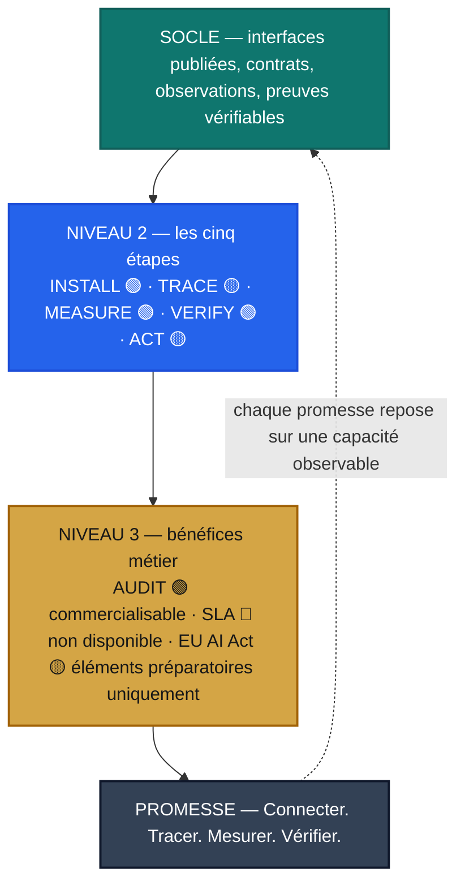
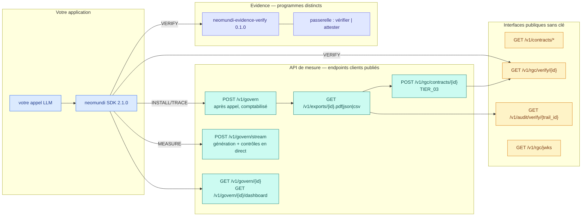
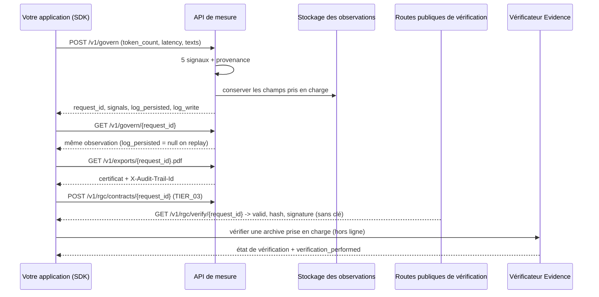
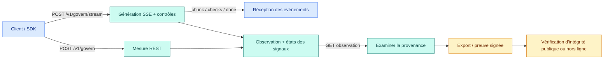

<b>Français</b> · <a href="PRODUCT_ARCHITECTURE.md">English</a>

# NeoMundi — Architecture produit

**Un produit ne se résume pas à ce qu’il promet. Il doit montrer ce qui rend ses capacités possibles.**

C’est pourquoi nous partageons en profondeur l’architecture de NeoMundi.

**Architecture produit publique · 16 novembre 2026.** Cette page cartographie la partie du produit accessible aux clients : interfaces, contrats, flux de données observables, preuves et limites. Les détails de déploiement interne et les constats d'exploitation n'y figurent volontairement pas.

**INSTALL → TRACE → MEASURE → VERIFY → ACT** · 🟢 Disponible · 🟡 Partiel / périmètre limité · 🔴 Indisponible

Les diagrammes représentent les **flux fonctionnels**, pas la topologie des services internes. Pour intégrer le produit, les contrats d'échange publiés et la documentation de la version installée du SDK font autorité.

> **Règle éditoriale :** ne présenter une capacité comme disponible que lorsqu'elle est indiquée 🟢 et confirmée par le service déployé et son contrat. Une capacité 🟡 ou 🔴 ne doit pas être présentée comme entièrement opérationnelle. Voir la [section 8](#8-règles-de-communication-et-de-documentation).

---

## 1. Promesse produit

**Connecter votre application d'IA. Tracer chaque interaction. Mesurer son comportement. Vérifier les preuves.**

**La mesure en exécution fournit un socle pour la surveillance et l'aide au pilotage par les systèmes intégrateurs.**

REST mesure les interactions instrumentées après appel ; le proxy de génération SSE pris en charge expose des événements selon son contrat publié. Les observations contrôlées répétées permettent des comparaisons dans la durée. Les enregistrements signés permettent une vérification indépendante. Cela n'étend pas ACT aux alertes automatiques, à l'application de politiques ou à la surveillance intégrée de production, et n'établit aucune garantie de latence en temps réel.

Voici ce que cette promesse signifie — et ne signifie pas — aujourd'hui :

| Promesse | Ce qui la rend possible | Ce qu'elle ne signifie pas |
|---|---|---|
| *Connecter votre application d'IA* | `pip install neomundi` ; une dépendance d'exécution ; adresse du service explicite. Un connecteur de framework existe 🟡 — `langchain-neomundi`, depuis GitHub, **pas encore sur PyPI** | Aucun connecteur pour un autre framework que LangChain ; ni les appels d'outils ni les étapes d'agent ne sont mesurés |
| *Tracer chaque interaction* | **Vous** instrumentez votre appel ; le SDK mesure la latence observable, transmet votre identifiant de corrélation et indique si le serveur a accusé réception **et enregistré** l'observation | Pas de route de traçage seule : une trace correspond à une observation mesurée et comptabilisée |
| *Mesurer son comportement* | Cinq signaux, chacun accompagné de sa provenance et d'un état `measured` / `not_measured` | Pas de seuil, de verdict de sûreté ni de label « safe » : l'interprétation relève de votre application |
| *Vérifier les preuves* | La plateforme recalcule une empreinte canonique et vérifie une signature Ed25519 via des routes **sans clé API** | 🔴 Cela ne prouve **pas** que la réponse de l'IA était vraie |

**ACT** est la cinquième étape stratégique. Aujourd'hui, elle signifie **exporter, attester et transmettre**, pas réagir automatiquement. Elle reste 🟡/🔴 selon la capacité : ne pas la vendre comme un dispositif de surveillance.

---

## 2. Architecture fonctionnelle

### INSTALL 🟢

`pip install --upgrade neomundi` (vérifier la version actuellement publiée). `httpx` est la seule dépendance d'exécution. Le paramètre `base_url` est obligatoire : aucune adresse n'est présumée. Le format de la clé est contrôlé localement afin qu'une clé invalide ne consomme pas de quota. Le SDK est typé (`py.typed`) et sa documentation existe en français et en anglais.

### Connecteurs de framework 🟡
Un seul connecteur existe, et son périmètre est assez étroit pour être énoncé en entier.

`langchain-neomundi` branche un `BaseCallbackHandler` LangChain qui pilote `client.trace()` : une
application LangChain est donc instrumentée sans écrire un appel de mesure par site. Les documents
récupérés sont lus depuis le rappel du récupérateur et transportés comme `rag_context`.

**Source d'installation, conformément à la règle 8 du [§8](#8-règles-de-discours-et-de-documentation) :**
le dépôt `github.com/neomundi-io/langchain-neomundi`, étiquette `v0.1.0`. **Il n'est pas publié sur
PyPI**, donc `pip install langchain-neomundi` ne fonctionne pas aujourd'hui. Un flux de publication
verrouillé est en place ; la publication elle-même sera un acte distinct et approuvé.

Ce qui justifie le 🟡 plutôt qu'un 🟢 : il ne couvre que LangChain, il ne mesure que les interactions
LLM — ni les appels d'outils, ni les étapes d'agent — et il est déclaré alpha. Ce qui est néanmoins
établi, par test et par exécution plutôt que par un README : 54 tests hors ligne sur Python
3.11–3.13 sous Linux, Windows et macOS ; et six observations soumises à la production puis relues
comme persistées, depuis une vraie chaîne pilotant un vrai modèle local.

Trois refus sont hérités du SDK et appliqués : aucun compte de jetons n'est jamais inventé, donc un
fournisseur qui n'en publie pas ne produit aucune observation ; aucune exception n'atteint
l'application hôte ; et chaque exécution rend une issue explicite, donc rien n'est mesuré en silence
et rien n'échoue en silence.

Les connecteurs pour d'autres frameworks seront construits et qualifiés un par un.

### TRACE 🟡

`client.trace()`, lorsqu'il est pris en charge par la version installée du SDK, est un gestionnaire de contexte entourant **votre propre appel** au fournisseur d'IA. Il mesure la latence réellement observable, transporte votre `client_trace_id` et soumet l'interaction.

Quatre refus sont prévus : ne jamais inventer le nombre de tokens ; ne rien soumettre si le bloc applicatif échoue ; ne pas ouvrir de connexion avec `submit=False` ; ne jamais annoncer qu'une observation a été enregistrée sans confirmation du serveur.

**Limites structurelles :** il n'existe pas de route de traçage seule ; terminer une trace déclenche une **mesure comptabilisée**. Le serveur ne conserve pas votre `client_trace_id` ; `audit.trace_id` est dérivé et n'est pas unique. **Le `request_id` du corps de réponse est la seule clé fiable de corrélation**, et non l'en-tête `X-Request-ID`.

Depuis le 15 novembre 2026, les deux routes publient `log_persisted` / `log_write`, afin de distinguer « reçu » et « enregistré » : `true` / `false` / `null`. `null` signifie que la question ne s'applique pas, notamment lors de la relecture d'une observation.

### MEASURE 🟢

Cinq signaux : `stability_score`, `coherence_score`, `semantic_risk`, `factual_hallucination_score`, `semantic_instability_score`. Leur disponibilité et la provenance des évaluateurs sont rapportées pour chaque observation ; l'hébergement et la configuration des évaluateurs peuvent varier.

**Invariant fondamental : un signal non mesuré n'est jamais publié comme un nombre.** Les champs `measured_signals` / `unmeasured_signals` indiquent l'état et la raison. Un agrégat non disponible vaut `null`, jamais `0.0`. Les empreintes des évaluateurs (`prompt_template_hash`, `inference_config_hash`, `config_fingerprint`) permettent de déterminer si deux observations ont été produites avec la même configuration.

**Limites :** `delta_g` compare l'observation à la requête précédente du même compte, quel que soit le sujet : ce n'est **pas** une mesure de dérive. En REST, le nombre de tokens est déclaré par l'appelant (`caller_declared`). Sur le chemin de repli SSE, l'unité est le nombre de `chunks`, pas les tokens. Il faut comparer la `measurement_version` renvoyée avec les compatibilités explicitement déclarées par le SDK installé.

### VERIFY 🟢 pour l'émission, 🔴 pour la vérité

Trois questions distinctes :

1. **Authenticité d'émission** — `GET /v1/rgc/verify/{request_id}` recalcule l'empreinte canonique à partir de l'observation source **et** vérifie la signature JWS Ed25519. Sans clé API et sans comptabilisation. 🟢
2. **Intégrité du document** — `GET /v1/audit/verify/{audit_trail_id}`, avec l'empreinte figurant sur le certificat. Sans clé API. 🟢 ⚠ Sans `?sha256=`, la réponse `valid: null` signifie qu'**aucune vérification n'a été effectuée**.
3. **Intégrité d'archive** — le vérificateur indépendant, installé avec `pip install neomundi-evidence-verify`. Le SDK l'appelle et restitue son code de sortie sans le modifier ; le SDK ne réalise pas lui-même cette vérification. 🟢

🔴 **Aucune de ces trois vérifications ne démontre qu'une réponse d'IA est vraie.** Une mesure vérifiée est une mesure dont l'intégrité est établie.

### ACT 🟡

Disponible aujourd'hui : export par observation (PDF / JSON / CSV), `audit_trail_id` déterministe et vérifiable publiquement, contrats RGC signés (`TIER_03`), rapports mensuels, historiques d'audit du compte, exports structurés en masse, flux d'événements et fil d'activité.

🔴 Non disponibles : seuils, alertes, moteur de SLA, détection de dérive, dossier EU AI Act prêt à l'emploi. **Par conception, le SDK n'embarque aucun seuil** : l'autorité d'exécution reste dans votre application.

---

## 3. Interfaces d'intégration publiées

| Interface côté client | Rôle | Limite |
|---|---|---|
| SDK Python | Soumettre et récupérer des mesures ; exposer les parcours de vérification pris en charge | Le SDK n'interprète pas les scores et n'impose pas de seuils |
| API de mesure — REST | Mesure après appel et récupération (`POST /v1/govern`, `GET /v1/govern/{id}`) | Mesures comptabilisées ; vérifier la persistance lorsqu'elle est indiquée |
| API de mesure — SSE | Génération en streaming et évaluation (`POST /v1/govern/stream`) | Les événements disponibles dépendent du contrat de streaming publié |
| **Contrat d'interopérabilité RGC (JSON)** | [Contrat d'échange des mesures, signé et versionné](https://github.com/neomundi-io/neomundi-measurement-interoperability), pour des systèmes consommateurs indépendants après MEASURE | Le destinataire vérifie provenance et intégrité, puis conserve l'interprétation, la politique et la décision. Ce transport RGC ne remplace pas le vérificateur indépendant des archives Evidence. La disponibilité dépend de la route API, du palier et de la version du contrat publiés. |
| Exports et preuves signées | Exporter les preuves d'une observation et vérifier leur émission | Un export ne démontre pas l'exactitude factuelle |
| Routes publiques de vérification | Vérifier les empreintes, signatures et condensats documentaires pris en charge, sans clé API | Une empreinte absente ou `valid: null` ne constitue pas une vérification |
| Vérificateur Evidence indépendant | Vérifier les archives prises en charge, séparément de l'API de mesure | La corrélation entre archive et observation n'est pas, en soi, attestée |
| Control Tower / Station / MCP | Interface client, campagnes et intégration avec les agents | Se reporter à la documentation publique de chaque composant |

**Sources de vérité :** contrats API publiés, documentation des versions du SDK et résultats de vérification reproductibles. La version de mesure de l'API et la version du package SDK sont deux notions distinctes.

---

## 4. Flux de données et de preuves

**Identifiants.** Le `request_id` contenu dans le corps de réponse constitue la référence centrale de corrélation. Le certificat porte un `audit_trail_id` permettant son contrôle d'intégrité public. Le `client_trace_id` reste **du côté de votre application**. `X-Request-ID` identifie la requête HTTP, pas l'observation.

**Données conservées.** La réponse de mesure et `_audit_context`, qui contient uniquement des longueurs. Le prompt n'est pas conservé en tant que prompt dans le stockage des observations. 🔴 Des **extraits textuels de la réponse peuvent être conservés** dans `quality.suspect_phrases` lorsque le score de factualité franchit son seuil. La formulation correcte est donc : *« le prompt n'est pas conservé ; des extraits de la réponse peuvent l'être au-delà du seuil de factualité »*, et non *« aucun contenu client n'est conservé »*.

La durée de conservation et la suppression des observations doivent être décrites dans les documents contractuels et de confidentialité applicables. La durée des sauvegardes d'infrastructure **n'est pas** une promesse de conservation des observations.

🔴 **Le lien Observation ↔ archive Evidence n'est pas attesté.** La passerelle Evidence accepte un `request_id` fourni par l'appelant et le renvoie tel quel : les deux éléments peuvent donc être corrélés par convention. **Une convention n'est pas une attestation** ; le lien attesté reste à construire.

---

## 5. Parcours client en direct — REST, SSE et Evidence

Le client peut intégrer NeoMundi par mesure REST après appel ou par un chemin SSE de génération en streaming pris en charge. Ce dernier peut exposer les événements `chunk`, `governance_check`, `coherence_check`, `hallucination_check`, `error` et `done`, sous réserve du contrat de streaming publié. L'événement final ne prouve pas, à lui seul, la persistance durable.

**Frontière d'interprétation :** les signaux de mesure, l'état de persistance, les contrôles d'intégrité et la vérification externe des archives répondent à des questions différentes. Il ne faut pas les confondre.

---

## 6. Bénéfices métier

| Problème | Capacité | Données | Preuve | Bénéfice | Message |
|---|---|---|---|---|---|
| « Nous ne pouvons pas reconstituer ce que notre IA a fait » | TRACE + MEASURE + récupération | Observation, 5 signaux et provenance | `GET /v1/govern/{id}` restitue l'observation ; `log_persisted` indique son enregistrement | Retrouver une interaction | **Retrouver une observation enregistrée tant qu'elle est disponible selon la politique de conservation applicable** 🟢 |
| « Personne ne croit nos chiffres internes » | VERIFY | Empreinte canonique et JWS Ed25519 | `GET /v1/rgc/verify/{id}`, **sans clé API** | Vérification par un tiers sans dépendre de notre compte | **Votre auditeur vérifie sans compte** 🟢 |
| « Nos mesures ne sont pas comparables dans le temps » | Provenance | Empreintes des évaluateurs et `measurement_version` | Trois empreintes par signal | Savoir quand une comparaison est légitime | **Savoir quand deux mesures sont comparables** 🟢 |
| « Les moyennes de notre fournisseur masquent les échecs » | Distinction mesuré / non mesuré | `unmeasured_signals` et raisons | Un agrégat indisponible vaut `null` | Rendre visibles les absences de mesure | **Un signal non mesuré n'est jamais un nombre** 🟢 |
| « Il nous faut un dossier de conformité » | Export et signature | PDF / JSON / CSV + RGC | `audit_trail_id` déterministe | Éléments techniques utilisables | 🟡 **Des éléments, pas un dossier complet** |
| « Nous devons garantir un SLA » | — | — | — | — | 🔴 **Ne pas commercialiser comme disponible** |

Trois cas d'usage prioritaires :

- **AUDIT 🟢 commercialisable aujourd'hui.** Observations récupérables, provenance par signal, exports et deux routes publiques de vérification sans clé. Limites : pas de chronologie rejouable ni d'écran de détail par observation à ce stade.
- **SLA 🔴 non commercialisable.** Pas de seuils, d'alertes ni de mesure de dérive. Les données de base existent ; pas le produit de surveillance.
- **EU AI Act 🟡 préparation, sans promesse de conformité.** Provenance, contrats signés et observations récupérables constituent des éléments techniques utiles. Aucun dossier prêt à l'emploi ni couverture réglementaire article par article.

À ne pas présenter comme disponibles : qualification des signaux, tests Cohere et dossier EU AI Act.

---

## 7. Parcours de démonstration de référence

Un parcours représentatif utilisant les capacités prises en charge du SDK et de l'API :

| Étape | Écran / action | Preuve produite |
|---|---|---|
| 1. INSTALL | Terminal — `pip install --upgrade neomundi` | Version du SDK installée |
| 2. TRACE + MEASURE | Console de mesure de Control Tower ; saisir la clé et envoyer un prompt | Texte en streaming ; trois événements de contrôle pendant la génération ; `done` avec longueur, octets et SHA-256 recalculé |
| 3. Détail | Carte de mesure alimentée par `loadDash` | Décision, G, cinq signaux avec état individuel, empreintes des évaluateurs, version de mesure |
| 4. VERIFY | « Contrat RGC », puis fenêtre privée sans clé sur `/v1/rgc/verify/{request_id}` | `valid: true`, `payload_hash_match`, `signature_valid`, `key_id` |
| 5. ACT | Export PDF ; ouverture de `/v1/audit/verify/{audit_trail_id}` avec l'empreinte imprimée | Vérification **sans clé API** |

À préciser à l'étape 5 : la vérification démontre **l'émission et l'intégrité**, pas la vérité de la réponse.

---

## 8. Règles de communication et de documentation

1. **Ne jamais écrire qu'une réponse d'IA est « vérifiée ».** Ici, « vérifié » signifie : émis par la plateforme et non altéré.
2. **Ne jamais affirmer qu'une interaction est enregistrée sans `log_persisted`.** `false` signifie *non confirmé*, pas *certainement absent*.
3. **Ne jamais présenter le traçage comme gratuit ou indépendant de la mesure.** Terminer une trace déclenche une mesure comptabilisée.
4. **Ne jamais écrire « aucun contenu client n'est conservé ».** Formulation correcte : *le prompt n'est pas conservé ; des extraits de réponse peuvent l'être au-delà du seuil de factualité*.
5. **Ne jamais qualifier `delta_g` de dérive.**
6. **Ne jamais annoncer une compatibilité `measurement_version` non déclarée.** Vérifier les compatibilités publiées et testées de l'API et du SDK.
7. **Ne jamais vendre ACT comme un système de réaction automatique.** Exporter et attester, oui ; surveiller et alerter, non.
8. **Distinguer PyPI et GitHub** dans les instructions d'installation.
9. **Ne jamais utiliser un README comme preuve suffisante.** Citer un fichier et une ligne, un contrat, un commit, un test ou une commande exécutée.
10. **Décrire une capacité prévue au futur, sans date**, tant qu'elle n'est pas confirmée 🟢.

**Vocabulaire :** *observation* (pas « log »), *signal* (pas « métrique »), *mesuré / non mesuré* (pas « manquant »), *authenticité d'émission* (pas « vérification » sans précision), *évaluateur* (pas « modèle »), *clé de corrélation = `request_id`*.

---

<a href="PRODUCT_ARCHITECTURE.md">English version</a> · <a href="../profile/README.fr.md">Présentation de NeoMundi en français</a>

