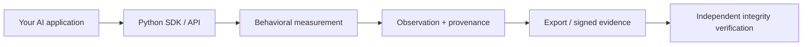

# NeoMundi — Product architecture

**Public product reference · 16 November 2026**

NeoMundi helps teams **connect AI applications, measure individual interactions, and independently verify the integrity of resulting evidence**. This page describes currently supported capabilities, their limits, and the outcomes they enable. It is a product reference, not a security architecture, an operational runbook, or a compliance certification.

> **Publication rule:** only describe a capability as available when supported by the deployed service and its published contract. Planned features must never be presented as shipped.

## 1. Product promise

**Connect. Trace. Measure. Verify.**

| Step | What you can do | Important boundary |
| --- | --- | --- |
| **INSTALL** 🟢 | Install the Python SDK with `pip install --upgrade neomundi` and configure an explicit API endpoint. | Integrations are explicit; automatic instrumentation is not provided. |
| **TRACE** 🟡 | Instrument an existing provider call, attach a client correlation identifier, and submit an observation. | Tracing is coupled to a metered measurement; it is not a standalone, free tracing service. Confirm SDK support for your installed version before using `client.trace()`. |
| **MEASURE** 🟢 | Request behavioral signals for an interaction, with provenance and explicit measurement status. | Scores are observations, not a safety certification, factual truth guarantee, or automated enforcement decision. |
| **VERIFY** 🟢 | Check the authenticity and integrity of issued evidence using public verification interfaces or an independent verifier. | Verification does **not** establish that an AI response was true. |
| **ACT** 🟡 | Export and attest evidence for review or downstream processes. | Automated thresholds, alerting, SLA enforcement, and drift detection are not product capabilities today. |

## 2. How the product works

An application submits an interaction for measurement. NeoMundi returns an observation identifier, available signals, and measurement provenance. Where supported, the observation can be retrieved and exported, and associated evidence can be checked independently.

**The response-body `request_id` is the reliable identifier for retrieving and correlating an observation.** Client-side identifiers are not a substitute for that server identifier. A successful API response alone must not be described as proof of persistence: use the reported persistence status where available.

### Behavioral measurement 🟢

Five signals are exposed:

- `stability_score`
- `coherence_score`
- `semantic_risk`
- `factual_hallucination_score`
- `semantic_instability_score`

Each signal distinguishes **measured** from **not measured** and carries provenance information. An unavailable measurement must not be converted into a numerical zero; withheld aggregates remain `null`. Evaluator configuration fingerprints and `measurement_version` help determine whether two observations are meaningfully comparable.

**Interpretation remains the application's responsibility.** In particular, `delta_g` compares an observation with a preceding account observation; it must not be advertised as longitudinal drift detection. Token counts or streaming units depend on the integration path and should not be presented as universally observed token usage.

### Evidence verification 🟢

Three separate integrity questions can be addressed:

1. **Emission authenticity:** a public verification route checks the canonical hash and Ed25519 signature of issued evidence.
2. **Document integrity:** an audit certificate can be checked against its digest. A response with `valid: null` is **not** a successful verification.
3. **Archive integrity:** the separate `neomundi-evidence-verify` package provides independent archive checks; it is not the measurement SDK itself.

These checks support auditability. They do **not** prove factual correctness, legal compliance, or a cryptographically attested connection between every observation and every external Evidence archive. Correlation alone is not attestation.

## 3. Product surfaces

| Surface | Purpose |
| --- | --- |
| **Measurement API** | Submit, retrieve, and export observations; consult published API contracts. |
| **Python SDK** | Integrate measurement and supported verification workflows into Python applications. |
| **Control Tower / Station** | Explore measurements and demonstrate available workflows; interface capabilities vary by view and authentication context. |
| **Evidence verifier** | Verify supported archives independently of the measurement service. |

For integration, use the **published API contracts and the documentation for the installed SDK version** as the compatibility reference. The service's measurement version and the SDK package version are distinct; do not infer compatibility from matching numbers. A new version must be tested and explicitly declared supported before it is advertised.

## 4. Data handling and customer commitments

Measurement involves customer-submitted interaction data. The prompt is not retained as a prompt in the observation store; **extracts of generated responses may be retained** under defined evaluation conditions. Do not describe the system as retaining *no customer content*.

Customers need clear, separate answers about:
- Which data categories are processed or retained, and for what purpose.
- The applicable observation retention and deletion rules.
- Subprocessors, hosting locations, access controls, and contractual protections.

**Retention commitments must be documented and verified before publication.** Infrastructure backup windows are not customer observation-retention promises. No claim that an interaction can be reopened “months later” is made here until the relevant retention and retrieval behavior is substantiated. Consult the applicable privacy notice and contractual documentation for binding terms.

## 5. Customer outcomes and boundaries

| Customer need | Available foundation | Boundary |
| --- | --- | --- |
| Reconstruct an AI interaction | Retrievable observations, signals, and provenance | Retrieval depends on successful persistence, access rights, and applicable retention. No universal long-term replay guarantee. |
| Support independent review | Signed evidence, hashes, public integrity checks | Evidence integrity is not a truth verdict. |
| Compare measurements responsibly | Per-signal status, evaluator fingerprints, measurement version | Comparability requires matching relevant configurations; no automatic drift conclusion. |
| Avoid hiding evaluator failures | Explicit unmeasured signals and reasons | A missing signal is not a zero or a pass. |
| Prepare audit materials | Observation exports and integrity evidence | Not a complete regulatory compliance package. |

**Available use case:** technical audit support through measured observations, provenance, exports, and integrity verification.

**Not available as a product promise:** automated SLA enforcement, monitoring alerts, drift detection, or an EU AI Act compliance pack. Existing evidence may contribute inputs to a customer's compliance work; NeoMundi does not claim that those inputs alone establish conformity.

## 6. Demonstration journey

1. **Install** the supported SDK.
2. **Submit and measure** an interaction using the documented API or supported UI.
3. **Inspect** the observation, its signal statuses, provenance, and persistence indication.
4. **Export** the available evidence.
5. **Verify** its integrity using the relevant public route or independent verifier.

A demonstration should distinguish an API acknowledgment from confirmed persistence, and an integrity check from factual verification. Features must be demonstrated against the currently deployed service, not inferred from a development branch.

## 7. Rules for downstream product communication

- Describe **observations**, **signals**, and **measured / not measured** states precisely.
- Never say that a verified AI answer is necessarily true.
- Never promise persistence, retention duration, or retrieval without supporting evidence.
- Never market tracing as an independent free service.
- Never label `delta_g` as drift detection.
- Never present future features in the present tense.
- Distinguish the SDK's package version from the API's measurement version.
- Substantiate material claims with published contracts, reproducible checks, or product demonstrations rather than marketing copy alone.

---

**Scope:** This page intentionally excludes internal deployment topology, source revisions, security gaps, incident history, private implementation details, and engineering backlog. Those belong in controlled operational records, not in the public product foundation.
