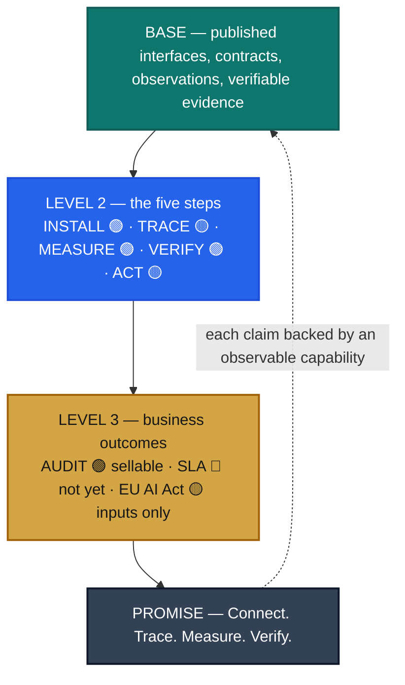
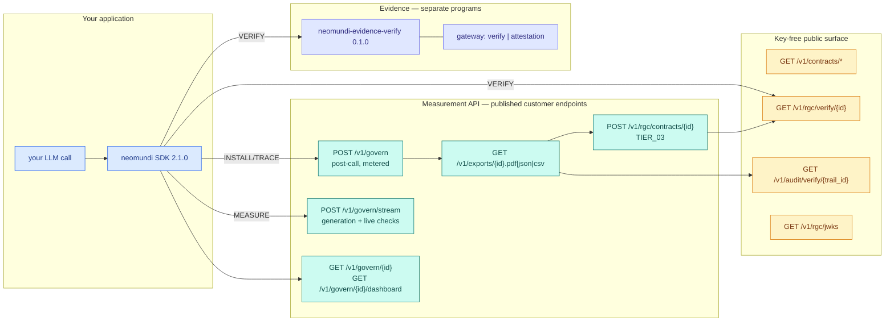
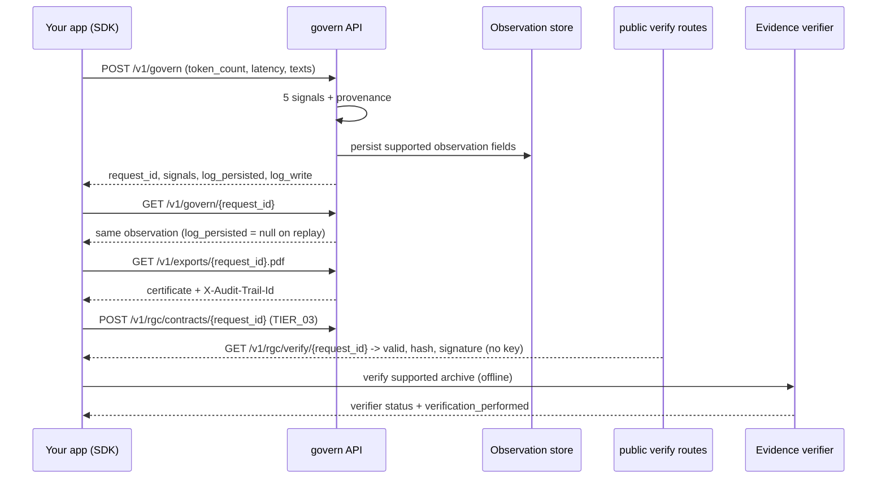
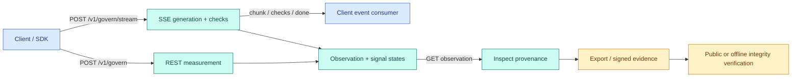

# NeoMundi — product architecture

**Public product architecture · 2026-11-16.** A technical map of the customer-facing product: interfaces, contracts, observable data flows, evidence and limitations. Internal deployment details and operational findings are deliberately excluded.

**INSTALL → TRACE → MEASURE → VERIFY → ACT** · 🟢 Available · 🟡 Partial / scoped · 🔴 Not available

The diagrams are functional maps, not a disclosure of internal service topology. Consult the published wire contracts and installed SDK documentation for authoritative integration details.

> **Rule for anyone editing a README, a web page or a deck from this document:** a capability may be
> described as available only where this document marks it 🟢. Nothing marked 🟡 or 🔴 may appear in
> a present-tense sentence. See [§8](#8-messaging--documentation-rules).

---

## 1. Product promise

**Connect your AI application. Trace every interaction. Measure its behavior. Verify the evidence.**

What that sentence is allowed to mean today, and nothing more:

| Promise fragment | What backs it | What it does not mean |
|---|---|---|
| *Connect your AI application* | `pip install neomundi` → 2.1.0; one dependency; explicit host | no framework hook, no auto-instrumentation |
| *Trace every interaction* | **you** instrument your call; the SDK measures latency, carries your correlation id, and reports what the server acknowledged **and recorded** | there is no trace-only route: a trace is a measured observation, and it is metered |
| *Measure its behavior* | five signals, each with provenance and an explicit `measured` / `not_measured` state | no threshold, no verdict, no "safe" label — interpretation stays in your application |
| *Verify the evidence* | the platform re-computes a canonical hash and verifies an Ed25519 signature, through routes that need **no key** | 🔴 it does **not** verify that the AI's answer was true |

**ACT** is our strategic fifth step. Today it means **export, attest, and hand over** — not react.
It is written here as a direction, and marked 🟡/🔴 throughout. Do not sell it as monitoring.

---

## 2. Functional architecture

### INSTALL 🟢
`pip install --upgrade neomundi` (check the currently published package version). `httpx` is the only runtime dependency. `base_url` is
mandatory — no host is ever assumed. Key format is checked locally so an invalid key cannot consume
a quota. Typed (`py.typed`). FR/EN documentation in the repo.

### TRACE 🟡
`client.trace()` (where supported by the installed SDK version) is a context manager around **your** provider call. It measures the latency it can
actually observe, carries a `client_trace_id` of yours, and submits the interaction.

Four refusals are part of the design: the token count is never invented; a failed application block
submits nothing; `submit=False` opens no socket; and nothing is reported as recorded that the server
did not report.

**Structural limits, to be stated every time:** there is no trace-only route — closing a trace is a
**metered measurement**; the server does not retain your `client_trace_id`; `audit.trace_id` is
derived and not unique; **`request_id` from the response body is the only reliable correlation key**
(not the `X-Request-ID` header).

Since 2026-11-15 both routes publish `log_persisted` / `log_write`, so "acknowledged" and "recorded"
are finally distinguishable — `true` / `false` / `null`, where `null` means the question does not
apply (a replayed row).

### MEASURE 🟢
Five signals: `stability_score`, `coherence_score`, `semantic_risk`,
`factual_hallucination_score`, `semantic_instability_score`. Their availability and evaluator provenance are reported per observation; evaluator hosting and configuration may vary.

The invariant that makes the numbers usable: **a signal that was not measured is never published as
a number.** `measured_signals` / `unmeasured_signals` carry the state and the reason; a withheld
aggregate is `null`, never `0.0`. Each signal carries evaluator fingerprints
(`prompt_template_hash`, `inference_config_hash`, `config_fingerprint`) — the only way to know two
observations ran under the same configuration.

**Limits:** `delta_g` compares with the previous request of the same account, whatever the question
— it is **not** a drift measure. On REST the token count is `caller_declared` by contract. On the
SSE fallback path the unit is `chunks`, not tokens. Check the returned `measurement_version` against the compatibility explicitly declared by the installed SDK; do not infer support.

### VERIFY 🟢 for emission, 🔴 for truth
Three distinct questions; keep them apart in every sentence:

1. **Emission authenticity** — `GET /v1/rgc/verify/{request_id}` recomputes the canonical hash from
   the source log **and** verifies the Ed25519 JWS. No key, not metered. 🟢
2. **Document integrity** — `GET /v1/audit/verify/{audit_trail_id}`, with the digest printed on the
   certificate. No key. 🟢 ⚠ without `?sha256=` the answer is `valid: null`: *nothing was verified*.
3. **Archive integrity** — the independent verifier, `pip install neomundi-evidence-verify`. The SDK
   calls it and republishes its exit code untranslated; it verifies nothing itself. 🟢

🔴 **None of the three says an AI answer was true.** A verified measurement is one you know was not
altered.

### ACT 🟡
Available today: per-observation export (PDF / JSON / CSV), a deterministic publicly verifiable
`audit_trail_id`, signed RGC contracts (TIER_03), monthly reports, account audit trails, bulk
structured export, an event stream and an activity feed.

🔴 Not available: thresholds, alerting, SLA engine, drift detection, EU AI Act pack. The SDK embeds
no threshold **by design** — execution authority stays in your application.

---

## 3. Published integration surfaces

| Customer-facing surface | Role | Boundary |
|---|---|---|
| Python SDK | Submit and retrieve measurements; expose supported verification workflows | The SDK does not interpret scores or enforce thresholds. |
| Measurement API — REST | Post-call measurement and retrieval (`POST /v1/govern`, `GET /v1/govern/{id}`) | Measurements are metered; persistence must be checked where reported. |
| Measurement API — SSE | Streaming generation and evaluation (`POST /v1/govern/stream`) | Event availability depends on the published streaming contract. |
| Exports and signed evidence | Export observation evidence and check issuance | An export is not proof of factual correctness. |
| Public verification endpoints | Validate supported hashes, signatures and document digests without an API key | A missing digest or `valid: null` does not constitute verification. |
| Independent Evidence verifier | Verify supported archives separately from the measurement API | Archive correlation with an observation is not itself attested. |
| Control Tower / Station / MCP | Customer-facing UI, campaigns, and agent integration | Refer to each surface's published documentation for scope. |

**Source of truth:** the published API contracts, SDK release documentation, and reproducible verification results. The API's measurement version and the SDK's package version are separate.

---

## 4. Data & evidence flow

**Identifiers.** The response-body `request_id` is the correlation spine. The certificate carries an `audit_trail_id` for its public integrity check. `client_trace_id` lives **only** on your side. `X-Request-ID`
identifies the HTTP request, not the observation.

**What is stored.** The measurement response plus `_audit_context` — **lengths only**. The prompt is not retained as a prompt in the observation store. 🔴 **Verbatim extracts of the response may be stored** in `quality.suspect_phrases` when
the factuality score passes its threshold: the correct sentence is *"the prompt is never retained;
extracts of the response are, above the factuality threshold"*, never "no client content is kept".
The retention and deletion of observations must be described in the applicable privacy and contractual documentation. Infrastructure backup windows are not observation-retention commitments.

🔴 **Observation ↔ Evidence archive is not attested.** The Evidence gateway accepts a
**caller-supplied** `request_id` and echoes it verbatim, so you can correlate the two by convention
today. Convention is not attestation; the attested link is unbuilt.

---

## 5. Live customer journey — REST, SSE and evidence

The customer can integrate through REST post-call measurement or a supported SSE streaming path. The latter may expose `chunk`, `governance_check`, `coherence_check`, `hallucination_check`, `error`, and `done` events, subject to the published streaming contract. The terminal event is not, by itself, proof of durable persistence.

**Interpretation boundary:** measurement signals, persistence status, integrity checks and external archive verification answer different questions. They must not be conflated.

---

## 6. Business outcomes

| Pain | Capability | Data | Proof | Benefit | Message |
|---|---|---|---|---|---|
| "We cannot reconstitute what our AI did" | TRACE + MEASURE + retrieval | observation + 5 signals + provenance | `GET /v1/govern/{id}` returns it; `log_persisted` says it was recorded | an interaction can be reopened | **Retrieve a persisted observation while it remains available under the applicable retention policy** 🟢 |
| "Nobody believes our internal numbers" | VERIFY | canonical hash + Ed25519 JWS | `GET /v1/rgc/verify/{id}`, **no key needed** | a third party checks without trusting us | **Your auditor verifies without an account** 🟢 |
| "Our measurements are not comparable over time" | provenance | evaluator fingerprints + `measurement_version` | three hashes per signal | you know when comparison is legitimate | **Know when two measurements are comparable** 🟢 |
| "Our vendor reports averages that hide failures" | measured/not-measured invariant | `unmeasured_signals` + reasons | a withheld aggregate is `null` | silence is visible instead of averaged | **An unmeasured signal is never a number** 🟢 |
| "We need a conformity file" | export + signature | PDF/JSON/CSV + RGC | `audit_trail_id` deterministic | real technical inputs | 🟡 **inputs, not a pack** |
| "We must hold an SLA" | — | — | — | — | 🔴 **do not sell** |

Three priority use cases:

- **AUDIT 🟢 sellable today.** Retrievable observations, per-signal provenance, exports, two
  key-free verification routes. Say the limits: no replayable timeline, no detail screen yet.
- **SLA 🔴 not sellable.** No thresholds, no alerting, no drift measure. The raw material exists;
  the product does not.
- **EU AI Act 🟡 prepare, never promise.** Provenance, signed contracts and retrievable observations
  are genuine inputs. There is no pack and no article-level coverage claim.

Planned and **not** to be presented as available: signal qualification, Cohere tests, EU AI Act pack.

---

## 7. Demonstration reference journey

A representative workflow, using supported SDK and API capabilities. What the user sees:

| Step | Screen | Evidence produced |
|---|---|---|
| 1. INSTALL | terminal — `pip install --upgrade neomundi` | installed SDK release |
| 2. TRACE + MEASURE | Control Tower governance panel; paste key, send a prompt | text streams; three check events during generation; `done` with length, bytes and SHA-256 recomputed |
| 3. Detail | governance card fills from `loadDash` | decision, G, five signals with per-signal state, evaluator fingerprints, measurement version |
| 4. VERIFY | "Contrat RGC", then a **private window with no key** on `/v1/rgc/verify/{request_id}` | `valid: true`, `payload_hash_match`, `signature_valid`, `key_id` |
| 5. ACT | export the PDF; open `/v1/audit/verify/{audit_trail_id}` with the printed digest | verified, **key-free** |

Say this out loud at step 5: it proves **emission and integrity**, not that the answer was true.
Saying it increases credibility; omitting it is the fastest way to lose a technical buyer.

---

## 8. Messaging & documentation rules

1. **Never write "verified" about an AI answer.** Verified = emitted by us and unaltered.
2. **Never write that an interaction is recorded without `log_persisted`.** `false` means *not
   confirmed*, not *certainly absent*.
3. **Never present a trace as free or trace-only.** Closing a trace is a metered measurement.
4. **Never write "no client content is kept."** Correct form: *the prompt is never retained;
   extracts of the response are, above the factuality threshold.*
5. **Never call `delta_g` drift.**
6. **Never claim `measurement_version` compatibility that is not declared.** The API and SDK must be checked against their published, tested compatibility declarations.
7. **Never sell ACT as reaction.** Export and attest, yes. Monitor and alert, no.
8. **Distinguish PyPI from GitHub** in every install instruction.
9. **Never use a README as evidence.** Cite a file and line, a contract, a commit, a test or an
   executed command.
10. **A planned feature is written in the future tense, with no date**, until this document marks it
    🟢.

Vocabulary: *observation* (not "log"), *signal* (not "metric"), *measured / not measured* (not
"missing"), *emission authenticity* (not "verification" alone), *evaluator* (not "model"),
*correlation key = `request_id`*.
