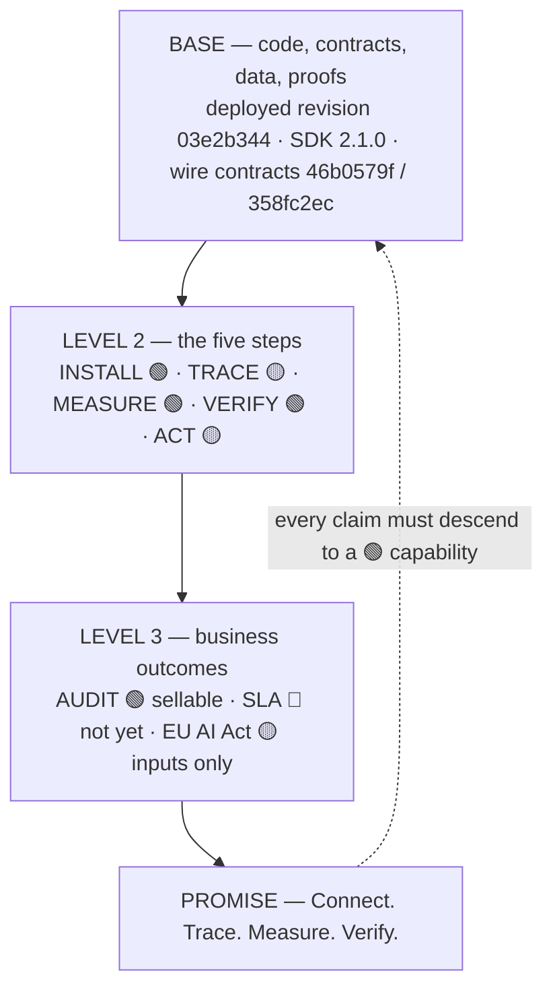
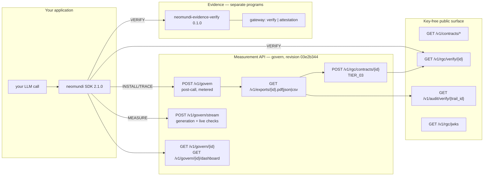
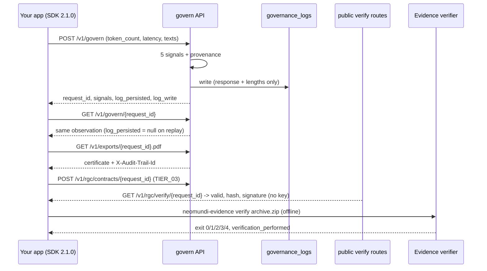

# NeoMundi — product architecture

**Reference document. 2026-11-15.** This is the base of the product pyramid: every claim above is
traceable to a capability below, and every capability carries its limit.

Its measurement is [`V2_FUNCTIONAL_AUDIT_2026-11-15.md`](V2_FUNCTIONAL_AUDIT_2026-11-15.md). Where
the two disagree, **the audit wins** — this document is then wrong and must be corrected.

> **Rule for anyone editing a README, a web page or a deck from this document:** a capability may be
> described as available only where this document marks it 🟢. Nothing marked 🟡 or 🔴 may appear in
> a present-tense sentence. See [§8](#8-messaging--documentation-rules).

---

## 1. Product promise

**Connect your AI application. Trace every interaction. Measure its behavior. Verify the evidence.**

What that sentence is allowed to mean today, and nothing more:

| Promise fragment | What backs it | What it does not mean |
|---|---|---|
| *Connect your AI application* | `pip install neomundi` → 2.1.0; one dependency; explicit host | no framework hook, no auto-instrumentation |
| *Trace every interaction* | **you** instrument your call; the SDK measures latency, carries your correlation id, and reports what the server acknowledged **and recorded** | there is no trace-only route: a trace is a measured observation, and it is metered |
| *Measure its behavior* | five signals, each with provenance and an explicit `measured` / `not_measured` state | no threshold, no verdict, no "safe" label — interpretation stays in your application |
| *Verify the evidence* | the platform re-computes a canonical hash and verifies an Ed25519 signature, through routes that need **no key** | 🔴 it does **not** verify that the AI's answer was true |

**ACT** is our strategic fifth step. Today it means **export, attest, and hand over** — not react.
It is written here as a direction, and marked 🟡/🔴 throughout. Do not sell it as monitoring.

---

## 2. Functional architecture

### INSTALL 🟢
`pip install --upgrade neomundi` (2.1.0). `httpx` is the only runtime dependency. `base_url` is
mandatory — no host is ever assumed. Key format is checked locally so an invalid key cannot consume
a quota. Typed (`py.typed`). FR/EN documentation in the repo.

### TRACE 🟡
`client.trace()` is a context manager around **your** provider call. It measures the latency it can
actually observe, carries a `client_trace_id` of yours, and submits the interaction.

Four refusals are part of the design: the token count is never invented; a failed application block
submits nothing; `submit=False` opens no socket; and nothing is reported as recorded that the server
did not report.

**Structural limits, to be stated every time:** there is no trace-only route — closing a trace is a
**metered measurement**; the server does not retain your `client_trace_id`; `audit.trace_id` is
derived and not unique; **`request_id` from the response body is the only reliable correlation key**
(not the `X-Request-ID` header).

Since 2026-11-15 both routes publish `log_persisted` / `log_write`, so "acknowledged" and "recorded"
are finally distinguishable — `true` / `false` / `null`, where `null` means the question does not
apply (a replayed row).

### MEASURE 🟢
Five signals: `stability_score`, `coherence_score`, `semantic_risk`,
`factual_hallucination_score`, `semantic_instability_score`. Three of five run on models hosted on
the service's own machine; factuality and semantic instability call one subcontractor; hosting is in
Switzerland.

The invariant that makes the numbers usable: **a signal that was not measured is never published as
a number.** `measured_signals` / `unmeasured_signals` carry the state and the reason; a withheld
aggregate is `null`, never `0.0`. Each signal carries evaluator fingerprints
(`prompt_template_hash`, `inference_config_hash`, `config_fingerprint`) — the only way to know two
observations ran under the same configuration.

**Limits:** `delta_g` compares with the previous request of the same account, whatever the question
— it is **not** a drift measure. On REST the token count is `caller_declared` by contract. On the
SSE fallback path the unit is `chunks`, not tokens. Production serves `measurement_version 3.5.0`,
which the SDK deliberately does **not** declare verified.

### VERIFY 🟢 for emission, 🔴 for truth
Three distinct questions; keep them apart in every sentence:

1. **Emission authenticity** — `GET /v1/rgc/verify/{request_id}` recomputes the canonical hash from
   the source log **and** verifies the Ed25519 JWS. No key, not metered. 🟢
2. **Document integrity** — `GET /v1/audit/verify/{audit_trail_id}`, with the digest printed on the
   certificate. No key. 🟢 ⚠ without `?sha256=` the answer is `valid: null`: *nothing was verified*.
3. **Archive integrity** — the independent verifier, `pip install neomundi-evidence-verify`. The SDK
   calls it and republishes its exit code untranslated; it verifies nothing itself. 🟢

🔴 **None of the three says an AI answer was true.** A verified measurement is one you know was not
altered.

### ACT 🟡
Available today: per-observation export (PDF / JSON / CSV), a deterministic publicly verifiable
`audit_trail_id`, signed RGC contracts (TIER_03), monthly reports, account audit trails, bulk
structured export, an event stream and an activity feed.

🔴 Not available: thresholds, alerting, SLA engine, drift detection, EU AI Act pack. The SDK embeds
no threshold **by design** — execution authority stays in your application.

---

## 3. Technical foundation

| Component | Responsibility | Contract | State |
|---|---|---|---|
| `govern` (API) | measure, persist, export, sign | `govern-rest-1.0` `46b0579f…`, `govern-sse-1.0` `358fc2ec…` | deployed `03e2b344` |
| `portal` (API) | accounts, keys, quotas, billing, usage lists, reports | internal | deployed `fc5fadd9` |
| Control Tower V2 | operator and customer interface | consumes both APIs | deployed `40dac840` |
| Python SDK | transport and exposure of measurements — never interpretation | `API_CONTRACT` | **PyPI 2.1.0** |
| Measurement MCP | agent access + response-contract validation | `gateway`-independent | `0.2.0` live, `0.3.0-rc.1` prepared |
| Evidence gateway | name the two states the engine cannot (`3` unavailable, `4` refused) | `gateway-request-v1`, `gateway-response-v1` | public |
| Evidence verifier | offline integrity | engine codes `0/1/2` | PyPI `0.1.0` |
| Evidence engine | produce and sign proofs | — | **private**, 12 CLI programs, not `pip`-installable |

Two rules that explain most of the design:

- **`/openapi.json` returns 404 in production.** The two documents served by `GET /v1/contracts/*`
  are the entire published description of the wire. They are byte-checked against a pinned public
  mirror on demand (`BYTE_MATCH`).
- **The API's `main` branch is not the production lineage** — production carries 47 commits `main`
  does not. Fixes ship as candidate branches on the production revision.

---

## 4. Data & evidence flow

**Identifiers.** `request_id` (body) is the spine. `audit_trail_id` =
`uuid5(NAMESPACE_URL, "neomundi-audit/{request_id}")` — deterministic, so a certificate always
verifies back to its observation. `client_trace_id` lives **only** on your side. `X-Request-ID`
identifies the HTTP request, not the observation.

**What is stored.** The measurement response plus `_audit_context` — **lengths only**. The prompt is
never stored. 🔴 **Verbatim extracts of the response are stored** in `quality.suspect_phrases` when
the factuality score passes its threshold: the correct sentence is *"the prompt is never retained;
extracts of the response are, above the factuality threshold"*, never "no client content is kept".
`rag_context` and `documents` are never persisted. No purge is in place; backups run on 14 days.

🔴 **Observation ↔ Evidence archive is not attested.** The Evidence gateway accepts a
**caller-supplied** `request_id` and echoes it verbatim, so you can correlate the two by convention
today. Convention is not attestation; the attested link is unbuilt.

---

## 5. V2 visualization architecture

`neomundi-control-tower` 4.1.0, React 18 + **recharts 2.12.7**. Three source files hold every chart:
`GovernanceDashboard` (`AreaChart` + `ReferenceLine`), `DashboardPaid` and `ApiKeyDetailPage`
(`BarChart`).

🟢 **A full single-interaction console already ships.** `GovernStreamPanel` runs `POST /v1/govern` or
`POST /v1/govern/stream`, consumes `chunk` / `governance_check` / `coherence_check` /
`hallucination_check` / `error` / `done`, loads `GET /v1/govern/{id}/dashboard`, exports
PDF/JSON/CSV and emits the RGC contract. **No new interface is needed to demonstrate the product.**

🔴 **One rupture governs the rest: two authentication domains.** The browser session authenticates
against the portal; every rich measurement read needs `X-API-Key` on `govern`. Stated in the code at
`GovernanceDashboard.tsx:219`. Consequences: the observation list carries 6 fields
(`request_id`, `decision`, `g_score`, `confidence`, `mode`, `timestamp`); there is **no
per-observation detail screen**; the governance dashboard stays empty until a key is pasted; no
account-level signal history can be charted.

The full `Component → data → endpoint → state → work left` matrix is in
[the audit, §3](V2_FUNCTIONAL_AUDIT_2026-11-15.md#3-v2-visualization-inventory--frontend_plateforme_v2--40dac840).
Priority order: resolve the auth domains → observation detail screen → signal time-series endpoint
(the `AreaChart` is built and waiting) → enrich `/v1/usage/logs`.

---

## 6. Business outcomes

| Pain | Capability | Data | Proof | Benefit | Message |
|---|---|---|---|---|---|
| "We cannot reconstitute what our AI did" | TRACE + MEASURE + retrieval | observation + 5 signals + provenance | `GET /v1/govern/{id}` returns it; `log_persisted` says it was recorded | an interaction can be reopened | **Reopen any interaction, months later** 🟢 |
| "Nobody believes our internal numbers" | VERIFY | canonical hash + Ed25519 JWS | `GET /v1/rgc/verify/{id}`, **no key needed** | a third party checks without trusting us | **Your auditor verifies without an account** 🟢 |
| "Our measurements are not comparable over time" | provenance | evaluator fingerprints + `measurement_version` | three hashes per signal | you know when comparison is legitimate | **Know when two measurements are comparable** 🟢 |
| "Our vendor reports averages that hide failures" | measured/not-measured invariant | `unmeasured_signals` + reasons | a withheld aggregate is `null` | silence is visible instead of averaged | **An unmeasured signal is never a number** 🟢 |
| "We need a conformity file" | export + signature | PDF/JSON/CSV + RGC | `audit_trail_id` deterministic | real technical inputs | 🟡 **inputs, not a pack** |
| "We must hold an SLA" | — | — | — | — | 🔴 **do not sell** |

Three priority use cases:

- **AUDIT 🟢 sellable today.** Retrievable observations, per-signal provenance, exports, two
  key-free verification routes. Say the limits: no replayable timeline, no detail screen yet.
- **SLA 🔴 not sellable.** No thresholds, no alerting, no drift measure. The raw material exists;
  the product does not.
- **EU AI Act 🟡 prepare, never promise.** Provenance, signed contracts and retrievable observations
  are genuine inputs. There is no pack and no article-level coverage claim.

Planned and **not** to be presented as available: signal qualification, Cohere tests, EU AI Act pack.

---

## 7. Demonstration reference journey

Five minutes, one API key, **no new code**. What the user sees:

| Step | Screen | Evidence produced |
|---|---|---|
| 1. INSTALL | terminal — `pip install --upgrade neomundi` | `neomundi-2.1.0` |
| 2. TRACE + MEASURE | Control Tower governance panel; paste key, send a prompt | text streams; three check events during generation; `done` with length, bytes and SHA-256 recomputed |
| 3. Detail | governance card fills from `loadDash` | decision, G, five signals with per-signal state, evaluator fingerprints, measurement version |
| 4. VERIFY | "Contrat RGC", then a **private window with no key** on `/v1/rgc/verify/{request_id}` | `valid: true`, `payload_hash_match`, `signature_valid`, `key_id` |
| 5. ACT | export the PDF; open `/v1/audit/verify/{audit_trail_id}` with the printed digest | verified, **key-free** |

Say this out loud at step 5: it proves **emission and integrity**, not that the answer was true.
Saying it increases credibility; omitting it is the fastest way to lose a technical buyer.

---

## 8. Messaging & documentation rules

1. **Never write "verified" about an AI answer.** Verified = emitted by us and unaltered.
2. **Never write that an interaction is recorded without `log_persisted`.** `false` means *not
   confirmed*, not *certainly absent*.
3. **Never present a trace as free or trace-only.** Closing a trace is a metered measurement.
4. **Never write "no client content is kept."** Correct form: *the prompt is never retained;
   extracts of the response are, above the factuality threshold.*
5. **Never call `delta_g` drift.**
6. **Never claim `measurement_version` compatibility that is not declared.** Production serves
   `3.5.0`; the SDK declares `("3.3.0", "3.3.1")`. The warning is correct.
7. **Never sell ACT as reaction.** Export and attest, yes. Monitor and alert, no.
8. **Distinguish PyPI from GitHub** in every install instruction.
9. **Never use a README as evidence.** Cite a file and line, a contract, a commit, a test or an
   executed command.
10. **A planned feature is written in the future tense, with no date**, until this document marks it
    🟢.

Vocabulary: *observation* (not "log"), *signal* (not "metric"), *measured / not measured* (not
"missing"), *emission authenticity* (not "verification" alone), *evaluator* (not "model"),
*correlation key = `request_id`*.
