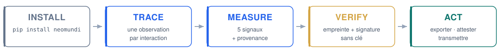

<div align="center">
<sub><a href="README.md">English</a> · <b>Français</b></sub>

# NeoMundi
### Savoir ce que fait votre IA. Prouver ce qui s'est passé.

**Un client conteste une réponse de votre IA. Pouvez-vous reconstruire ce qui s'est passé et présenter des éléments contrôlables ?**
NeoMundi est l'infrastructure de mesure qui conserve les interactions instrumentées, rend
des signaux comportementaux avec leur provenance, et en fait une preuve qu'un tiers peut vérifier —
sans compte NeoMundi pour les contrôles publics pris en charge.

**INSTALL → TRACE → MEASURE → VERIFY → ACT**

[](https://pypi.org/project/neomundi/)
[](https://github.com/neomundi-io/neomundi-runtime-measurement)
[](https://github.com/neomundi-io/neomundi-evidence-gateway)
[](https://github.com/neomundi-io/neomundi-station-public)
[](https://github.com/neomundi-io/neomundi-use-cases)

**[Démarrage rapide](#démarrage-rapide)** · **[Architecture produit](https://github.com/neomundi-io/.github/blob/main/docs/PRODUCT_ARCHITECTURE.fr.md)** · **[Créer un compte](https://controltower.neomundi.io/welcome)**
</div>

---

## Le problème

Une fonctionnalité d'IA peut passer tous les tests et rester impossible à justifier.

- **Trois semaines plus tard, un client conteste une réponse.** Vous avez une ligne de journal, pas le comportement.
- **Votre fournisseur publie une moyenne.** Vous ne pouvez pas distinguer un signal mesuré d'un signal qui n'a jamais tourné.
- **Un auditeur demande une preuve.** Tout ce que vous pouvez montrer vient de vous, et c'est précisément le problème.

NeoMundi conserve l'observation, mesure le comportement avec sa provenance attachée, et rend
l'enregistrement vérifiable par quelqu'un qui ne vous fait pas confiance.

## Ce que vous obtenez, en un parcours

<p align="center">
  <picture>
    <source media="(prefers-color-scheme: dark)" srcset="https://raw.githubusercontent.com/neomundi-io/.github/main/profile/assets/journey-fr-dark.svg">
    
  </picture>
</p>

| Étape | Ce qu'elle fait réellement | Disponible |
|---|---|---|
| **INSTALL** | `pip install neomundi` — une seule dépendance d'exécution, typé, aucun hôte supposé | **Oui** — [PyPI](https://pypi.org/project/neomundi/) |
| **TRACE** | Vous instrumentez votre propre appel. Le SDK le chronomètre, porte votre identifiant de corrélation, soumet l'interaction et dit si le serveur l'a **enregistrée** — pas seulement accusé réception. | **Oui.** Il n'existe aucune route de traçage seul : une trace est une observation mesurée, et elle est facturée. |
| **MEASURE** | Cinq signaux comportementaux, chacun avec les empreintes de son évaluateur. Un signal non mesuré n'est **jamais** publié comme un nombre. | **Oui** — [sémantique des signaux](https://github.com/neomundi-io/neomundi-metric-contract) · [ce que les évaluateurs peuvent et ne peuvent pas établir](https://github.com/neomundi-io/neomundi-metric-contract/blob/main/EVALUATORS.md) |
| **VERIFY** | Nous recalculons l'empreinte canonique depuis l'observation stockée et vérifions une signature Ed25519 — par des routes qui n'exigent **aucune clé d'API**. L'intégrité d'archive est contrôlée par un vérificateur **séparé et indépendant**. | **Oui** — [Evidence](https://github.com/neomundi-io/neomundi-evidence-gateway) · [`neomundi-evidence-verify`](https://pypi.org/project/neomundi-evidence-verify/) |
| **ACT** | Aujourd'hui : auditer, exporter (PDF / JSON / CSV), attester par signature, transmettre à un tiers. | **Oui, pour ces quatre usages.** Les seuils, les alertes et la surveillance de SLA **ne font pas** partie du produit. |

**Ce que VERIFY ne signifie pas.** Il établit qu'un enregistrement a été émis par cette plateforme
et n'a pas été altéré. Il n'établit **pas** qu'une réponse d'IA était vraie. Nous tenons ces deux
choses séparées à dessein, et toute présentation bâtie sur cette page doit le faire aussi.

## Démarrage rapide

```sh
pip install neomundi
```

```python
import os
from neomundi import NeoMundiClient

with NeoMundiClient(
    api_key=os.environ["NEOMUNDI_API_KEY"],
    base_url="https://api.neomundi.io",
) as client:

    # Vous appelez votre propre modèle. NeoMundi mesure ce qui en revient.
    with client.trace(model_name="gpt-4o") as t:
        answer, usage = my_llm(question)
        t.record(prompt=question, response=answer,
                 token_count=usage.total_tokens)

    r = t.record_
    print(r.request_id)                               # la clé de corrélation
    print(r.result.governance.decision)               # ALLOW / FLAG
    print(r.result.format_score("g_score"))           # un None reste None
    print(r.result.measured_signals)                  # ce qui a été mesuré
    print(r.result.unmeasured_signals)                # et pourquoi le reste ne l'a pas été
    print(r.result.get("log_persisted"))              # est-ce enregistré ?
```

Puis vérifiez le contrat de fil auquel l'API s'engage — **sans clé, sans compte, immédiatement** :

```sh
curl https://api.neomundi.io/v1/contracts/govern-rest-1.0.json
```

`token_count` et `latency_ms` ne sont jamais inventés à votre place : sans eux, rien n'est envoyé.
[SDK Python](https://github.com/neomundi-io/neomundi-python-sdk) ·
[English](https://github.com/neomundi-io/neomundi-python-sdk) ·
[Limites connues](https://github.com/neomundi-io/neomundi-python-sdk/blob/main/KNOWN_LIMITATIONS_FR.md)

## Architecture et écosystème

| Composant | Rôle | Commencer ici |
|---|---|---|
| **SDK Python** | Transporte et expose les mesures. N'embarque aucun seuil et ne dérive aucun verdict — l'interprétation reste dans votre application. | [SDK](https://github.com/neomundi-io/neomundi-python-sdk) · [PyPI](https://pypi.org/project/neomundi/) |
| **API de mesure** | Mesure, conserve, exporte et signe. REST post-call et proxy de génération SSE. | [Runtime Measurement](https://github.com/neomundi-io/neomundi-runtime-measurement) · [Démarrage](https://github.com/neomundi-io/neomundi-runtime-measurement/blob/main/QUICKSTART.md) |
| **Contrat d'interopérabilité RGC** | Interface JSON publiée pour transmettre des mesures runtime signées et versionnées à des systèmes indépendants. Le système destinataire vérifie et applique sa propre politique ; le contrat ne donne aucune autorité d'exécution. | [Contrat RGC · schémas, exemples et vérification](https://github.com/neomundi-io/neomundi-measurement-interoperability) |
| **MCP** | Accéder à la mesure depuis les assistants d'IA et l'outillage d'agents, avec validation des contrats de réponse. | [Measurement MCP](https://github.com/neomundi-io/neomundi-measurement-mcp) |
| **Evidence** | Vérification indépendante : intégrité d'archive, liens entre artefacts, attestations Ed25519. Rapporte ce qui est démontré **et ce qui n'est pas éprouvé**. | [Gateway Evidence](https://github.com/neomundi-io/neomundi-evidence-gateway) · [Guide du vérificateur](https://github.com/neomundi-io/neomundi-evidence-gateway/blob/main/verifier/README.md) |
| **Station** | Campagnes contrôlées : exécuter, conserver, capturer le contexte et la provenance, exporter des enregistrements auditables. | [Station](https://github.com/neomundi-io/neomundi-station-public) · [Guide pilote](https://github.com/neomundi-io/neomundi-station-public/blob/main/START_HERE.md) |
| **Control Tower (web)** | Interface opérateur : console de mesure en direct, consommation, rapports, exports, contrats signés. | [Créer un compte](https://controltower.neomundi.io/welcome) |

Comment tout cela s'articule, avec l'état et la limite de chaque capacité :
**[Architecture produit](https://github.com/neomundi-io/.github/blob/main/docs/PRODUCT_ARCHITECTURE.md)** —
et l'audit sur lequel elle repose, affirmation par affirmation :
**[Audit fonctionnel du 2026-11-15](https://github.com/neomundi-io/.github/blob/main/docs/V2_FUNCTIONAL_AUDIT_2026-11-15.md)**.

## Bénéfices métier

| Usage | État | Sur quoi il repose |
|---|---|---|
| **AUDIT** — reconstituer, examiner, prouver | **Disponible aujourd'hui** | Une observation récupérable, la provenance par signal, l'export PDF / JSON / CSV, et deux routes de vérification publiques qui n'exigent aucune clé |
| **SLA** — surveiller, qualifier les écarts | **Feuille de route** | La matière première existe ; il n'y a ni moteur de seuil, ni alerte, ni mesure de dérive. Ce n'est pas un produit aujourd'hui. |
| **EU AI Act** — alimenter un dossier de conformité | **Feuille de route** | Provenance, contrats signés et observations récupérables sont de véritables entrées techniques. Il n'y a ni pack, ni revendication de couverture article par article. |

La qualification des signaux et les tests d'évaluateurs étendus sont des directions de
développement, pas des fonctionnalités. Les mesures soutiennent la supervision humaine et les
décisions techniques ; elles ne certifient ni une vérité, ni une conformité juridique.

## Par où commencer

**1. [Installer le SDK](https://pypi.org/project/neomundi/)** → **2. [Explorer la documentation](https://github.com/neomundi-io/neomundi-runtime-measurement/blob/main/QUICKSTART.md)** → **3. [Lancer votre première mesure](https://controltower.neomundi.io/welcome)**

**Aller plus loin :** [Cas d'usage et pilotes](https://github.com/neomundi-io/neomundi-use-cases) ·
[Qualification expérimentale](https://github.com/neomundi-io/neomundi-metrology-validation) ·
[Contrats d'échange](https://github.com/neomundi-io/neomundi-measurement-interoperability) ·
[Hugging Face · NeoMundi Research](https://huggingface.co/neomundi-research) ·
[Observatoire de l'IA](https://github.com/neomundi-io/neomundi-ai-observatory)

**Gouvernance et données :** [Preuves opérationnelles AI Act & RGPD](https://github.com/neomundi-io/ai-act-rgpd) ·
[Protection des données et confidentialité](https://github.com/neomundi-io/neomundi-io-data-protection).
Les flux de données et la rétention dépendent du chemin d'intégration et de déploiement.

**Discuter d'un pilote :** [contact@neomundi.io](mailto:contact@neomundi.io)

## Infrastructure et programmes de soutien

NeoMundi bénéficie d'un soutien en infrastructure et de programmes pour startups :

- [Infomaniak](https://www.infomaniak.com/) — partenaire d'infrastructure.
- [OVHcloud Startup Program](https://startup.ovhcloud.com/) — participant au programme.
- [NVIDIA Inception](https://www.nvidia.com/en-us/startups/) — membre du programme.

Ces relations n'impliquent aucune certification ni validation de résultats scientifiques.

<div align="center">

**[Découvrir NeoMundi](https://neomundi.io)** · **[Cas d'usage](https://github.com/neomundi-io/neomundi-use-cases)** · **[Discuter d'un pilote](mailto:contact@neomundi.io)**

</div>
