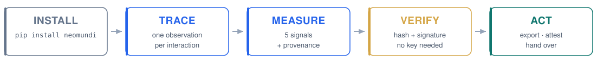

<div align="center">
<sub><b>English</b> · <a href="README.fr.md">Français</a></sub>

# NeoMundi
### Know what your AI does. Prove what happened.

**Less guesswork. More evidence.**

**A customer challenges an AI response. Can you reconstruct what happened and provide evidence they can check?**
NeoMundi turns instrumented AI interactions into **auditable observations**, measurable behavioural signals with provenance, and independently verifiable technical evidence.
Supported public verification checks require no NeoMundi account.

*One measurement primitive. Multiple applications. Multiple infrastructures.*

**INSTALL → TRACE → MEASURE → VERIFY → ACT**

[](https://pypi.org/project/neomundi/)
[](https://github.com/neomundi-io/neomundi-runtime-measurement)
[](https://github.com/neomundi-io/neomundi-evidence-gateway)
[](https://github.com/neomundi-io/neomundi-station-public)
[](https://github.com/neomundi-io/neomundi-use-cases)

**[Quick start](#quick-start)** · **[Product architecture](https://github.com/neomundi-io/.github/blob/main/docs/PRODUCT_ARCHITECTURE.md)** · **[All components](https://github.com/orgs/neomundi-io/repositories)** · **[Create an account](https://controltower.neomundi.io/welcome)**
</div>

---

## The problem

An AI feature can pass every test and still be impossible to account for.

- **Three weeks later, a customer disputes an answer.** You have a log line, not the behaviour.
- **Your vendor reports an average.** You cannot tell a measured signal from one that never ran.
- **An auditor asks for proof.** Everything you can show comes from you, and that is exactly the problem.

NeoMundi keeps the observation, measures the behaviour with its provenance attached, and makes the
record verifiable by someone who does not trust you.

## What you get, in one journey

<p align="center">
  <picture>
    <source media="(prefers-color-scheme: dark)" srcset="https://raw.githubusercontent.com/neomundi-io/.github/main/profile/assets/journey-en-dark.svg">
    
  </picture>
</p>

| Step | What it actually does | Available |
|---|---|---|
| **INSTALL** | `pip install neomundi` — one runtime dependency, typed, no host assumed | **Yes** — [PyPI](https://pypi.org/project/neomundi/) |
| **TRACE** | You instrument your own call. The SDK times it, carries your correlation id, submits the interaction and reports whether the server **recorded** it — not just acknowledged it. | **Yes.** There is no trace-only route: a trace is a measured observation, and it is metered. |
| **MEASURE** | Five behavioural signals, each with its evaluator fingerprints. A signal that was not measured is **never** published as a number. | **Yes** — [signal semantics](https://github.com/neomundi-io/neomundi-metric-contract) · [what evaluators can and cannot establish](https://github.com/neomundi-io/neomundi-metric-contract/blob/main/EVALUATORS.md) |
| **VERIFY** | We recompute the canonical hash from the stored observation and verify an Ed25519 signature — through routes that need **no API key**. Archive integrity is checked by a **separate, independent** verifier. | **Yes** — [Evidence](https://github.com/neomundi-io/neomundi-evidence-gateway) · [`neomundi-evidence-verify`](https://pypi.org/project/neomundi-evidence-verify/) |
| **ACT** | Today: audit, export (PDF / JSON / CSV), signed attestation, hand-over to a third party. | **Yes, for those four.** Thresholds, alerting and SLA monitoring are **not** part of the product. |

**What VERIFY does not mean.** It establishes that a record was emitted by this platform and has not
been altered. It does **not** establish that an AI answer was true. We keep those two apart on
purpose, and so should any deck built from this page.

## Quick start

```sh
pip install neomundi
```

```python
import os
from neomundi import NeoMundiClient

with NeoMundiClient(
    api_key=os.environ["NEOMUNDI_API_KEY"],
    base_url="https://api.neomundi.io",
) as client:

    # You call your own model. NeoMundi measures what came back.
    with client.trace(model_name="gpt-4o") as t:
        answer, usage = my_llm(question)
        t.record(prompt=question, response=answer,
                 token_count=usage.total_tokens)

    r = t.record_
    print(r.request_id)                               # the correlation key
    print(r.result.governance.decision)               # ALLOW / FLAG
    print(r.result.format_score("g_score"))           # None stays None
    print(r.result.measured_signals)                  # what was measured
    print(r.result.unmeasured_signals)                # and why the rest was not
    print(r.result.get("log_persisted"))              # was it recorded?
```

Then verify the wire contract the API commits to — **no key, no account, right now**:

```sh
curl https://api.neomundi.io/v1/contracts/govern-rest-1.0.json
```

`token_count` and `latency_ms` are never invented for you: without them nothing is sent.
[Python SDK](https://github.com/neomundi-io/neomundi-python-sdk) ·
[Français](https://github.com/neomundi-io/neomundi-python-sdk/blob/main/README_FR.md) ·
[Known limitations](https://github.com/neomundi-io/neomundi-python-sdk/blob/main/KNOWN_LIMITATIONS.md)

## Architecture and ecosystem

| Component | Role | Start here |
|---|---|---|
| **Python SDK** | Transports and exposes measurements. Embeds no threshold and derives no verdict — interpretation stays in your application. | [SDK](https://github.com/neomundi-io/neomundi-python-sdk) · [PyPI](https://pypi.org/project/neomundi/) |
| **Measurement API** | Measures, persists, exports and signs. REST post-call and SSE generation proxy. | [Runtime Measurement](https://github.com/neomundi-io/neomundi-runtime-measurement) · [Quickstart](https://github.com/neomundi-io/neomundi-runtime-measurement/blob/main/QUICKSTART.md) |
| **RGC interoperability contract** | Published JSON interface for transporting signed, versioned runtime measurements to independent consumers. The consumer verifies and applies its own policy; the contract does not grant execution authority. | [RGC contract · schema, examples and verification](https://github.com/neomundi-io/neomundi-measurement-interoperability) |
| **MCP** | Access measurement from AI assistants and agent tooling, with response-contract validation. | [Measurement MCP](https://github.com/neomundi-io/neomundi-measurement-mcp) |
| **Evidence** | Independent verification: archive integrity, artefact links, Ed25519 attestations. Reports what is demonstrated **and what is untested**. | [Evidence gateway](https://github.com/neomundi-io/neomundi-evidence-gateway) · [Verifier guide](https://github.com/neomundi-io/neomundi-evidence-gateway/blob/main/verifier/README.md) |
| **Station** | Controlled campaigns: run, retain, capture context and provenance, export auditable records. | [Station](https://github.com/neomundi-io/neomundi-station-public) · [Pilot guide](https://github.com/neomundi-io/neomundi-station-public/blob/main/START_HERE.md) |
| **Control Tower (web)** | Operator interface: live measurement console, consumption, reports, exports, signed contracts. | [Create an account](https://controltower.neomundi.io/welcome) |

How these fit together, with each capability's state and limit:
**[Product architecture](https://github.com/neomundi-io/.github/blob/main/docs/PRODUCT_ARCHITECTURE.md)** —
and the audit it is built on, claim by claim:
**[Functional audit, 2026-11-15](https://github.com/neomundi-io/.github/blob/main/docs/V2_FUNCTIONAL_AUDIT_2026-11-15.md)**.

## Business outcomes

| Use case | State | What it rests on |
|---|---|---|
| **AUDIT** — reconstitute, examine, prove | **Available today** | A retrievable observation, per-signal provenance, PDF / JSON / CSV export, and two public verification routes that need no key |
| **SLA** — monitor, qualify deviations | **Roadmap** | The raw material exists; there is no threshold engine, no alerting and no drift measure. Not a product today. |
| **EU AI Act** — feed a conformity file | **Roadmap** | Provenance, signed contracts and retrievable observations are genuine technical inputs. There is no pack and no article-level coverage claim. |

Signal qualification and extended evaluator testing are development directions, not features.
Measurements support human oversight and technical decisions; they are not certification of truth
or legal compliance.

## Start here

**1. [Install the SDK](https://pypi.org/project/neomundi/)** → **2. [Explore the documentation](https://github.com/neomundi-io/neomundi-runtime-measurement/blob/main/QUICKSTART.md)** → **3. [Run your first measurement](https://controltower.neomundi.io/welcome)**

**Explore further:** [Use cases and pilots](https://github.com/neomundi-io/neomundi-use-cases) ·
[Experimental qualification](https://github.com/neomundi-io/neomundi-metrology-validation) ·
[Exchange contracts](https://github.com/neomundi-io/neomundi-measurement-interoperability) ·
[Hugging Face · NeoMundi Research](https://huggingface.co/neomundi-research) ·
[AI Observatory](https://github.com/neomundi-io/neomundi-ai-observatory)

**Governance and data:** [AI Act & GDPR operational evidence](https://github.com/neomundi-io/ai-act-rgpd) ·
[Data protection and confidentiality](https://github.com/neomundi-io/neomundi-io-data-protection).
Data flows and retention depend on the integration and deployment path.

**Discuss a pilot:** [contact@neomundi.io](mailto:contact@neomundi.io)

## Infrastructure and programme support

NeoMundi benefits from infrastructure and startup-program support:

- [Infomaniak](https://www.infomaniak.com/) — infrastructure partner.
- [OVHcloud Startup Program](https://startup.ovhcloud.com/) — programme participant.
- [NVIDIA Inception](https://www.nvidia.com/en-us/startups/) — programme member.

These relationships do not imply certification or endorsement of scientific results.

<div align="center">

**[Explore NeoMundi](https://neomundi.io)** · **[Use cases](https://github.com/neomundi-io/neomundi-use-cases)** · **[Discuss a pilot](mailto:contact@neomundi.io)**

</div>
